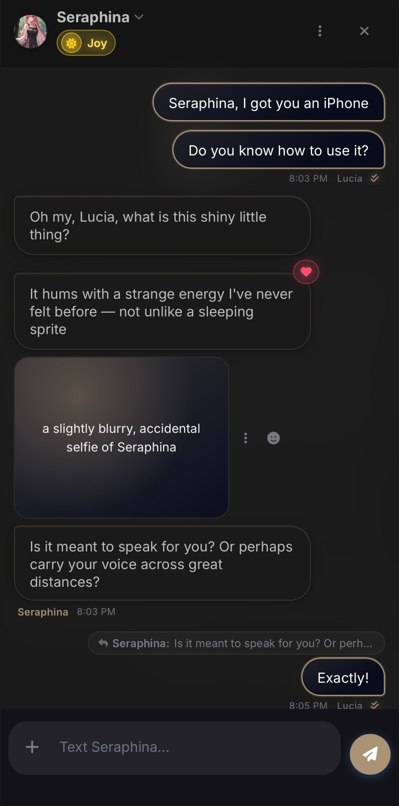
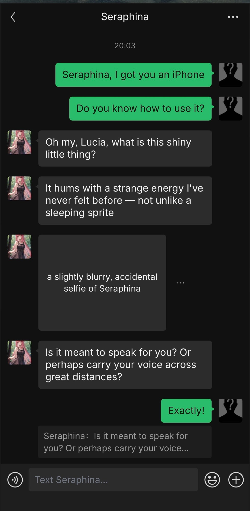
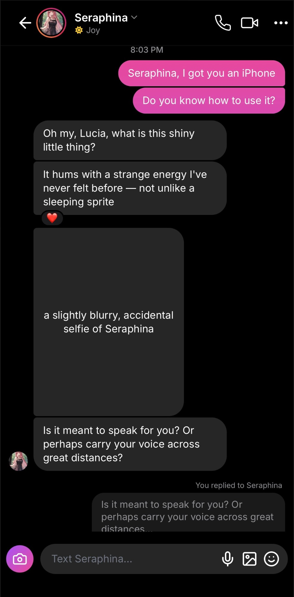
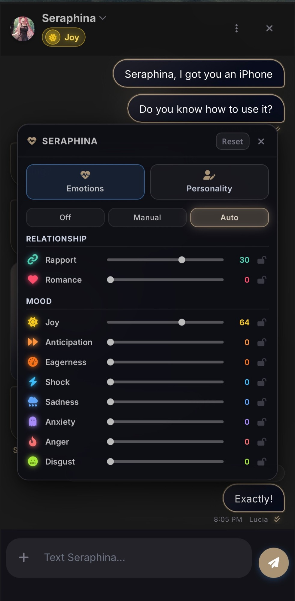
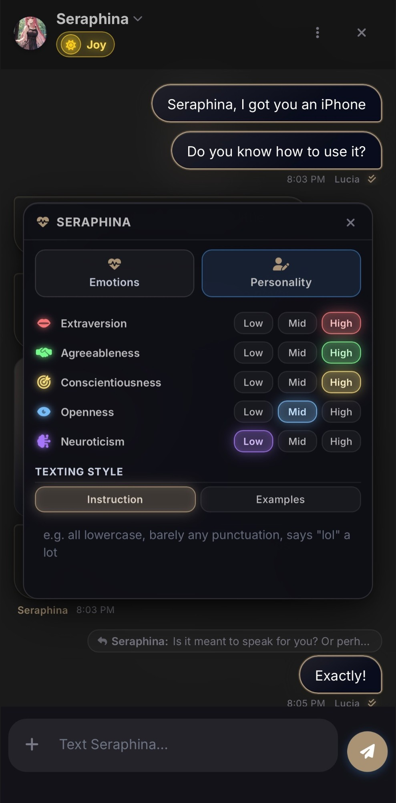

<div align="center">

# Echogram

Text your SillyTavern characters like they're on your phone.

&nbsp;
&nbsp;


&nbsp;


<sub>A personal fork of <a href="https://github.com/mattjaybe/SillyTavern-EchoText">SillyTavern-EchoText</a> by mattjaybe.</sub>

</div>

## Features

- A floating chat panel beside your roleplay.
- Echogram, WeChat or Instagram look, chosen per character.
- Characters know the opening message and what's happening in your story.
- Replies come as several short texts, at the length you pick.
- Photos, voice messages, money transfers, files and links.
- Tapbacks and quoted replies, from you and the character.
- Rapport, Romance, Desire, moods, Big Five, Morality and texting style, set by hand or left to change on their own.
- Characters text you first, sometimes with a photo or voice message.
- Memories and summaries of long chats.
- Swipes, group chats, saved chats, themes, custom avatars and fonts.
- Works on mobile.

## Install

In SillyTavern, open **Extensions → Install extension** and paste:

```
https://github.com/JL0952/SillyTavern-EchoText-Custom
```

## Credits

Original project by mattjaybe. MIT License, see [LICENSE](LICENSE).
